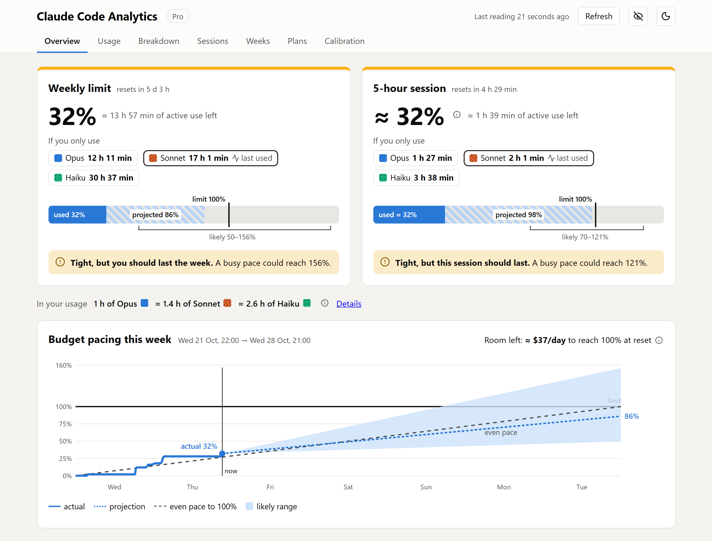
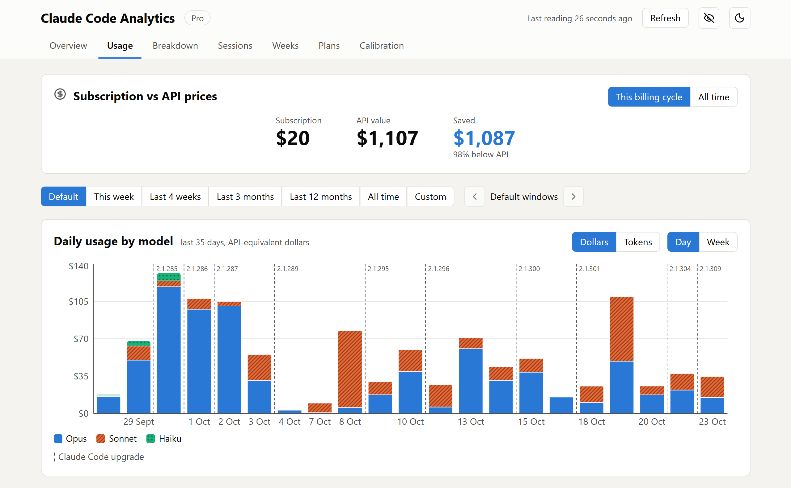
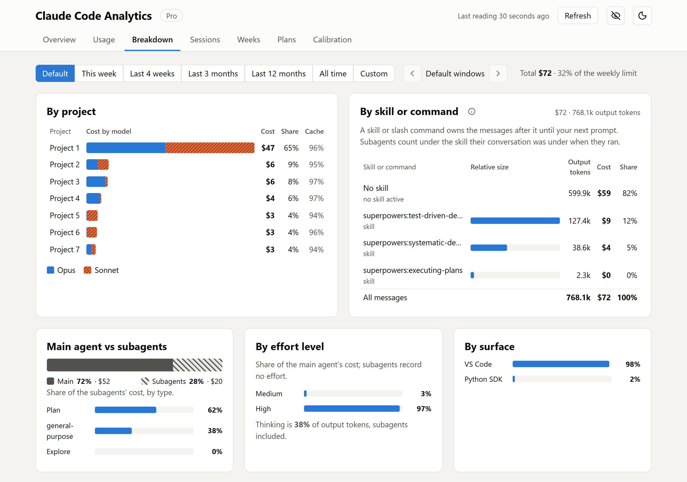
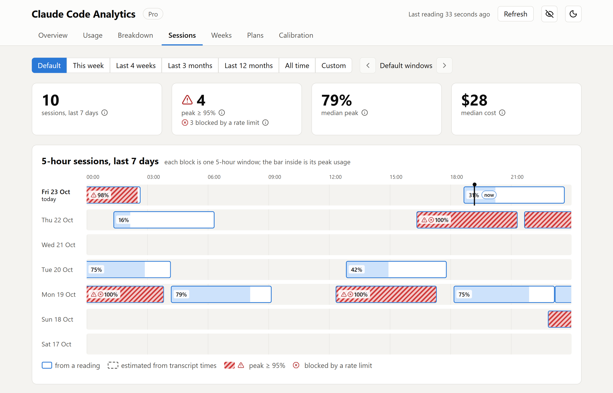
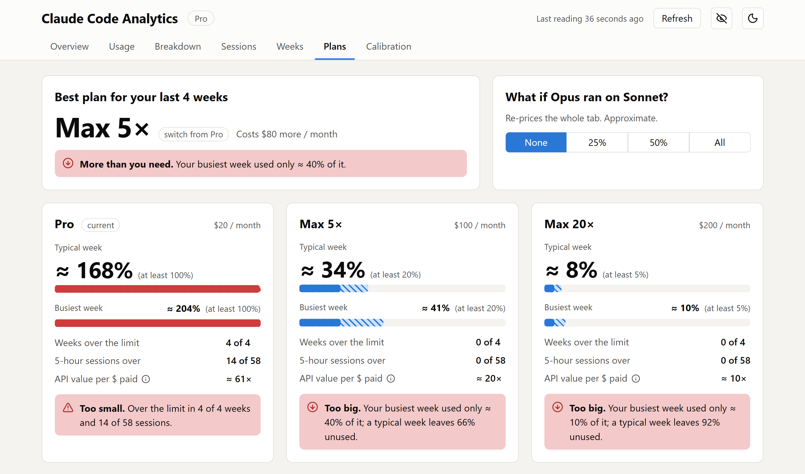
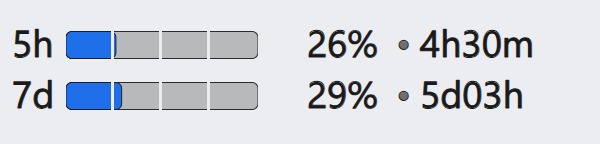

# Claude Code Analytics

**Will I last the week? Am I on the right plan? Where do my tokens go?**

A local dashboard for your Claude Code subscription. It reads the transcripts
Claude Code already writes on your machine, forecasts your 5-hour and weekly
limits, and shows where the usage goes. Nothing leaves your machine.

<picture>
  <source media="(prefers-color-scheme: dark)" srcset="docs/screenshots/overview-dark.png">
  
</picture>

## Highlights

- **Limit forecasts**: your weekly and 5-hour %, where they'll land at reset, and
  how much active work time you have left.
- **Budget pacing**: this week against an even pace, and the daily spend left.
- **Subscription vs API prices**: what your plan saved you this billing cycle.
- **Breakdowns**: by model, project, conversation, skill, subagent, tool and effort level.
- **History**: past 5-hour sessions and weeks, the ones that hit the limit or got rate-limited.
- **Plan fit**: whether Pro, Max 5× or Max 20× would have fit your last weeks.
- **Taskbar widget** (Windows): both limits at a glance, always visible.
- **Costs no usage**: it never calls Claude, so it uses no tokens and doesn't count toward your limits.
- **Private by design**: never stores message content; anonymize mode for screenshots.
- Light and dark themes, colorblind-friendly charts (every series has a texture).

## Tour

<table>
  <tr>
    <td width="50%">
      <b>Usage</b>: API-equivalent cost per day by model, Claude Code upgrades marked, when you work, cache efficiency.
      <picture>
        <source media="(prefers-color-scheme: dark)" srcset="docs/screenshots/usage-dark.png">
        
      </picture>
    </td>
    <td width="50%">
      <b>Breakdown</b>: where the usage goes, by project, skill, subagent, effort, tool and conversation.
      <picture>
        <source media="(prefers-color-scheme: dark)" srcset="docs/screenshots/breakdown-dark.png">
        
      </picture>
    </td>
  </tr>
  <tr>
    <td width="50%">
      <b>Sessions</b>: your 5-hour windows on a timeline, with its peak and the rate limits hit.
      <picture>
        <source media="(prefers-color-scheme: dark)" srcset="docs/screenshots/sessions-dark.png">
        
      </picture>
    </td>
    <td width="50%">
      <b>Plans</b>: which plan would have fit your recent weeks, and what it would cost.
      <picture>
        <source media="(prefers-color-scheme: dark)" srcset="docs/screenshots/plans-dark.png">
        
      </picture>
    </td>
  </tr>
</table>

Also: **Weeks** (the last 12 weekly windows, day by day) and **Calibration**
(limit readings, settings and how well the forecasts fit them).

## Getting started

Requires Node ≥ 22.18.

```sh
git clone https://github.com/Pierre-Demessence/ClaudeCodeAnalytics.git
cd ClaudeCodeAnalytics
npm install
npm run hook:install -- --apply # adds the collector hook to ~/.claude/settings.json (with a backup)
npm run dashboard               # builds and opens the dashboard
```

Run `npm run hook:install` without `--apply` to print the hook and add it yourself.
The hook imports new transcripts in the background after every Claude Code
response; opening the dashboard does too. Neither uses any of your usage: they
read files Claude Code already writes and never call Claude, and the hook adds
nothing to your conversation.

**Limit readings.** The % of your limits comes from one of two sources, set in
the Calibration tab:

- **Manual**: type in what `/usage` shows from time to time.
- **Usage endpoint** (opt-in): reads the numbers behind `/usage` automatically,
  at most every 15 minutes. It uses Claude Code's undocumented endpoint and your
  login token; see [Privacy](#privacy). Like `/usage`, it only reads the
  numbers and costs no usage.

The forecasts appear after a few readings; until then, everything else already works.

Collected data lives in `~/.claude-code-analytics/` (override with
`CCA_DATA_DIR`). Claude Code deletes old transcripts after `cleanupPeriodDays`
(in `~/.claude/settings.json`), but messages already imported are kept.

## Privacy

Everything runs locally. The only network call is the usage endpoint, and only
once you turn it on.

| Path | What is used | When |
| --- | --- | --- |
| `~/.claude/projects/**/*.jsonl` | Token counts, model, session, working directory, branch, tool names and sizes, skill and slash command names, conversation titles, and the times of rate-limit hits, overloads and compactions. Never message content or tool inputs. | Every collector run |
| `~/.claude/projects/**/*.meta.json` | A subagent's type, never its description. | Every collector run |
| `~/.claude.json` (or `~/.claude/.claude.json`) | `subscriptionCreatedAt` only (the billing day, unless the plan history sets it), never the email or account ids. | Every collector run |
| `~/.claude/.credentials.json` | The OAuth access token, its expiry, the plan type and rate-limit tier. | Only with the usage endpoint on |
| `~/.claude/settings.json` | Read and edited, with a backup, to add the hook. | Only when you run `hook:install -- --apply` |

The token is held in memory, sent only to
`https://api.anthropic.com/api/oauth/usage`, and never logged, stored or
refreshed: Claude Code refreshes it. The whole client is
[`src/collector/endpoint.ts`](src/collector/endpoint.ts).

The eye button in the header masks project names, paths, branches and
conversation titles, for sharing screenshots like the ones above.

## Good to know

- Usage is priced at public API rates, as a common unit across models. Plan
  limits are assumed to scale with those prices.
- Only this machine's transcripts are counted. claude.ai chat usage counts
  toward the same limits: the endpoint separates it, and a manual reading can
  too; otherwise it is counted as Claude Code.
- Other plans' figures are approximate, from Anthropic's advertised 5× and 20×
  multipliers; the Plans tab shows how well your own weeks match them.
- When a reading is old, the dashboard says so and estimates the usage since
  from transcripts.

## Extras

### Taskbar widget (Windows)

<picture>
  <source media="(prefers-color-scheme: dark)" srcset="docs/screenshots/widget-dark.png">
  
</picture>

Docked left of the notification area: both limits as a bar, a percent and the
time to reset. Click it to open the dashboard; right-click for "Start with
Windows" and "Quit". A small native process (about 10 MB). Needs the
[always-on dashboard](#always-on-dashboard-docker) running,
[Rust](https://www.rust-lang.org/) (`mise install`) and the Visual Studio C++
build tools.

```sh
npm run widget:install # builds it, copies it to %LOCALAPPDATA%\Claude Code Analytics Widget, starts it
```

Only one widget runs at a time: quit the installed one before `widget:dev` or a
new `widget:install`.

### Always-on dashboard (Docker)

`npm run docker:up` builds the image and serves the dashboard at
<http://analytics.claudecode.localhost>. Needs Docker Desktop and a running
Traefik reverse proxy on an external `proxy` network. The container mounts
`~/.claude` read-only and shares `~/.claude-code-analytics` with the hook, which
keeps running on the host. It serves the version it was built from: run
`npm run docker:up` again after updating.

## Development

| Script | Description |
| --- | --- |
| `npm run dev` | Dashboard with hot reload. |
| `npm run dashboard` | Build and open the dashboard (`vite preview`). |
| `npm run collect` | Run the collector once (`-- --force` skips the endpoint throttle). |
| `npm run backtest` | Replay the forecasts on your data and score them. |
| `npm run docker:up` | Build and (re)start the always-on Docker dashboard. |
| `npm run widget:dev` | Run the taskbar widget from the source; redraws when `widget/widget.svg` is saved. |
| `npm run widget:install` | Build the taskbar widget and install it for the user. |
| `npm run widget:test` | Test and lint the widget (`cargo test`, `clippy`). |
| `npm run build` | Type-check, then build. |
| `npm run lint` | Lint with ESLint (`lint:fix` to auto-fix). |
| `npm test` | Run Vitest once (`test:watch`, `test:coverage`). |

Built with Vite, React and TypeScript, scaffolded with
[create-corniflex](https://github.com/Pierre-Demessence/create-corniflex). The
widget is Rust. Project docs: [backlog](docs/backlog.md) and
[decisions](docs/decisions.md); agent notes: [AGENTS.md](AGENTS.md).

## License

[MIT](LICENSE)
